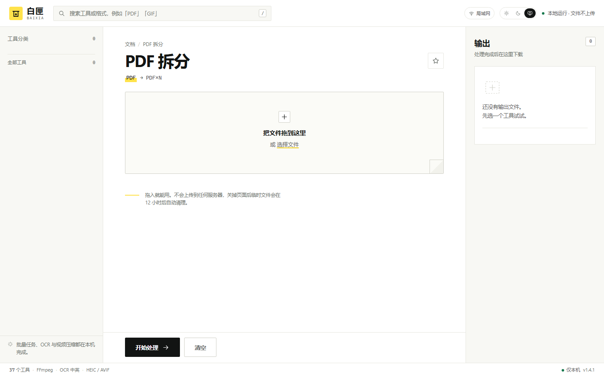
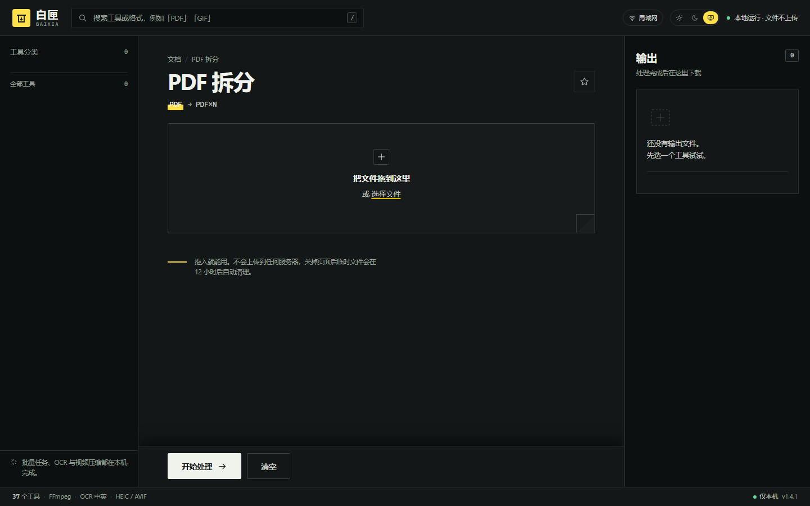
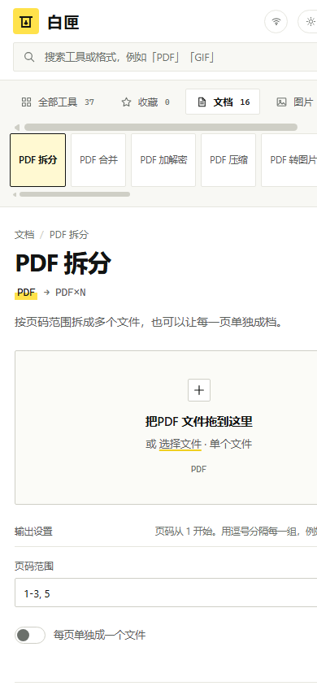

# 白匣 BAIXIA · 本地文件工坊

<p align="center">
  
  
  
  
  
  
  
</p>

<p align="center">
  <strong>现代化、纯本地运行的个人多媒体与文档工坊。</strong><br>
  文档、图片、视频、音频的格式转换、智能压缩、AI 抠图、超分放大与语音字幕提取，全部在你的电脑本地完成，<strong>绝不上传任何云端</strong>。
</p>

---

## 📸 界面预览

<p align="center">
  
  
</p>

<p align="center">
  <em>三栏式极简工作台：左侧全能工具树 · 中间操作与参数区 · 右侧任务与输出托盘（支持深浅色无缝切换）</em>
</p>

<p align="center">
  
</p>

<p align="center">
  <em>自适应移动端与局域网无线互传：手机在同 Wi-Fi 下扫码秒传相册文件，告别数据线</em>
</p>

---

## 🌟 核心亮点

- 🔒 **100% 纯本地运行 · 绝对隐私安全**  
  默认仅监听 `127.0.0.1` 本机回环地址，不调用任何第三方商业云端 API。合同法务、个人证件照、财务报表、私人家庭视频毫无数据外泄隐患。任务临时文件完成 12 小时后自动本地粉碎。
- 🤖 **端侧内置离线 AI 大全（无需 PyTorch / 免云端费用）**  
  - **Faster-Whisper (tiny)**：纯本地音视频语音识别，毫秒级精准提取中英文双语字幕（`.srt` / `.txt`）；
  - **U2-Netp**：轻量级显著性主体抠图，发丝级透明通道生成与证件照一键智能换底；
  - **Real-ESRGAN**：低分辨率老照片与动漫插画 2× / 3× / 4× 超分辨率智能无损放大；
  - **RapidOCR**：本地离线扫描件文本识别，直接生成带文字层的双层可搜索 PDF。
- ⚡ **超强性能与硬件加速**  
  - 启动时自动探测 NVIDIA NVENC、Intel Quick Sync (QSV) 与 AMD AMF 显卡硬件编码器；
  - **快慢双线程池队列分离**（`baixia-light` 与 `baixia-heavy`），后台长视频转码再也不卡死轻量小文件；
  - **Server-Sent Events (SSE)** 毫秒级任务流式推送与 XHR 真实传输速率实时监控。
- 📑 **真·无损 PDF 压缩与 Office 保真**  
  - PDF 压缩仅重采样内嵌高精位图，完整保留可复制、可检索的矢量文字层与书签；
  - Word 转 PDF 优先调用本地 Word/WPS COM 接口与 LibreOffice，保证排版、表格与公式 1:1 绝对保真。
- 🎨 **匠心交互体验**  
  - 自由文件拖拽（HTML5 Drag & Drop）排序；
  - PDF 交互式画廊工作台（缩略图网格重排、单页旋转、批量废页剔除）；
  - 任务处理前后文件大小与画质对比视图（Before / After）；
  - 链式流转处理（“继续处理”一键流向下一个工具）；
  - 参数记忆与收藏夹、全局快捷键（`/` 聚焦搜索、`Ctrl+Enter` 立即启动）。

---

## 🚀 快速开始

### 环境要求
- **操作系统**：Windows 10 / 11（x64）
- **Python**：Python 3.10 或更高版本（需勾选 Add to PATH）
- **FFmpeg**：建议安装并加入系统环境变量（项目支持自动探测 `ffmpeg.exe`）

### 一键启动（推荐）
1. **本机独立使用**：双击 `启动白匣.vbs`，无黑框静默启动，默认自动在浏览器打开 `http://127.0.0.1:8765`；
2. **手机无线互传**：双击 `启动白匣（局域网）.vbs`，手机连接同一 Wi-Fi，在网页右上角点击「局域网」扫码即可无线互传相册文件；
3. **关闭服务**：双击 `停止白匣.vbs`（关闭浏览器标签页不会中断后台正在处理的任务）。

### 命令行启动
```powershell
# 1. 克隆代码仓库
git clone https://github.com/HUA503/baixia-workshop.git
cd baixia-workshop

# 2. 安装 Python 核心依赖
python -m pip install -r requirements.txt

# 3. 运行服务
python app.py
```

---

## 🛠️ 全能工具箱一览（37 个）

### 📄 文档处理（16 个）

| 工具名称 | 转换链路 | 功能说明 |
| :--- | :--- | :--- |
| **PDF 拆分** | PDF → PDF×N | 按指定页码范围拆分；支持每一页单独成档 |
| **PDF 合并** | PDF×N → PDF | 按自选顺序多合一，保留原始文字、矢量与画质 |
| **PDF 加解密** | PDF → 加密 / 解密 PDF | AES-256 密码加锁或移除已知密码 |
| **PDF 压缩** | PDF → PDF | 默认无损清理；图像优化只重采样内嵌位图，保留文字层可搜索 |
| **PDF 转图片** | PDF → PNG / JPG | 逐页导出为高清图片，可自定义 DPI (72~400) |
| **图片转 PDF** | 图片×N → PDF | 多图拼合，支持 A4 居中留白或贴合原图尺寸 |
| **PDF 转 Word / 文本** | PDF → DOCX / MD / TXT / HTML | 智能抽取标题、列表与表格；适合转成语料喂给大模型 |
| **PDF OCR 识别** | 扫描件 PDF → 文字 / 可搜索 PDF | 离线中英文识别，生成带隐形文字层的双层 PDF |
| **PDF 页面管理** | PDF → 重排 PDF | **交互式画廊工作台**：缩略图拖拽排序、单页旋转、批量删页 |
| **PDF 水印防伪** | PDF → 带水印 PDF | 全文平铺或居中自定义文字水印，可调透明度、角度与字号 |
| **Word 转 Markdown** | DOCX → MD | 提取标题、粗斜体、列表、超链接与表格，支持导出图片素材 |
| **Word 转网页** | DOCX → HTML | 单文件内嵌离线网页，便于直接分享与归档 |
| **Word 转 PDF** | DOCX → PDF | 优先调用本机 Word/WPS COM，其次 LibreOffice，保证 1:1 版式 |
| **Markdown 转 Word** | MD → DOCX | 快速将排版好的 Markdown 渲染成正规 Word 文档 |
| **Markdown 转 PDF** | MD → PDF | 干净雅致的书卷排版，非常适合打印或交付 |
| **表格全能转换** | XLSX / CSV → MD / CSV / JSON / XLSX | 支持多工作表、表头识别，CSV 转 Excel 智能识别数值类型 |

### 🖼️ 图片与视觉（9 个）

| 工具名称 | 转换链路 | 功能说明 |
| :--- | :--- | :--- |
| **批量格式转换** | JPG / PNG / WebP / AVIF / HEIC / TIFF… | 批量互转，支持无损清除 EXIF 隐私元数据与限宽控制 |
| **图片智能压缩** | 图片×N → 更小的图片 | 质量/长边控制，或输入目标 KB 自动二分逼近体积 |
| **批量缩放** | 图片×N → 指定尺寸 | 等比居中适应、裁剪填满或强制拉伸，快速适配发布规格 |
| **批量重命名** | 图片×N → 新文件名 | 支持模板占位符：`{name}`、`{n:02}`、`{date}`、`{ext}` |
| **一键 AI 抠图** | 图片×N → 透明 PNG | 内置 **U2-Netp** 模型端侧发丝级主体抠图，可切颜色容差 |
| **智能证件照制作** | 图片×N → 一寸 / 二寸 / 护照 / 签证 | 自动人脸检测构图，标准毫米规格、DPI 调整与智能换底（红/蓝/白） |
| **图片 OCR** | 图片×N → TXT / DOCX | 离线中英文印刷体文字识别，支持多图顺序拼接输出 |
| **生成网站图标** | 图片 → ICO | 自动打包 16×16 至 256×256 六种标准多尺寸合一图标 |
| **AI 超分高清放大** | 图片×N → 2× / 3× / 4× | 集成 **Real-ESRGAN** 本地超分辨率模型，清晰修复模糊老图 |

### 🎬 视频制作（10 个）

| 工具名称 | 转换链路 | 功能说明 |
| :--- | :--- | :--- |
| **视频格式转换** | MP4 / MKV / MOV / AVI / WebM… | H.264 / VP9 编码，自动探测并启用 NVENC / QSV 显卡加速 |
| **视频容量压缩** | 视频 → MP4 | 支持三档画质预设，或直接滑动指定目标 MB（上限自动锁定原视频） |
| **视频片段裁剪** | 视频 → 片段 | 掐头去尾截取任意区间；快速模式采用流复制不重新编码 |
| **视频画面裁剪** | 视频 → 任意画幅 MP4 | 16:9 / 9:16 / 1:1 / 4:3 自由裁剪，轻松去黑边或横竖屏转换 |
| **视频无缝拼接** | 视频×N → MP4 | 多段片段自动统一度量、分辨率、帧率与声道序列拼接 |
| **视频转 GIF** | 视频 → 高清 GIF | 截取任意片段制作表情包，自动双遍调色板调优抖动抗锯齿 |
| **提取视频音频** | 视频 → MP3 / WAV / M4A / FLAC | 高保真单独抽取声音轨道，码率自由可调 |
| **视频抽帧截图** | 视频 → 图片序列 ZIP | 按指定秒数间隔抽取无损帧序列，自媒体选封面神器 |
| **视频消音静音** | 视频 → 无声 MP4 | 剔除音轨并保留纯净视频流，适合制作循环背景 |
| **GIF 转视频** | GIF → MP4 / WebM | 将动态表情包转换回高兼容性视频，便于二次剪辑 |

### 🎵 音频与字幕（2 个）

| 工具名称 | 转换链路 | 功能说明 |
| :--- | :--- | :--- |
| **音频格式互转** | MP3 / WAV / FLAC / M4A / AAC / OGG… | 主流无损与有损音频互转，码率与采样率可精细控制 |
| **AI 语音转字幕** | 视频 / 音频 → SRT / TXT / VTT | 内置 **Faster-Whisper**，纯本地离线转写带时间戳的字幕文件 |

---

## ⚙️ 环境变量与高级配置

支持通过系统环境变量自定义运行行为：

| 变量名 | 默认值 | 作用说明 |
| :--- | :--- | :--- |
| `BAIXIA_PORT` | `8765` | 服务监听端口（被占用时自动顺延） |
| `BAIXIA_HOST` | `127.0.0.1` | 绑定网卡地址（局域网模式自动设为 `0.0.0.0`） |
| `BAIXIA_MAX_UPLOAD_GB`| `4` | 单次任务上传总文件体积上限 (GB) |
| `BAIXIA_LIGHT_WORKERS`| CPU 核心数 | 轻量任务并发线程数（图片、重命名、小文档） |
| `BAIXIA_HEAVY_WORKERS`| `1` | 重量级任务并发线程数（视频压制、音频转码、超分） |
| `BAIXIA_VIDEO_ENCODER`| `自动探测` | 强制指定编码器：`h264_nvenc` / `h264_qsv` / `libx264` |
| `BAIXIA_WARM_OCR` | `1` | 启动时是否在后台预热 RapidOCR 识别引擎 |
| `BAIXIA_NO_BROWSER` | `0` | 设为 `1` 时启动后不自动唤起默认浏览器 |
| `FFMPEG_PATH` | `系统 PATH` | 手动指定 `ffmpeg.exe` 的绝对物理路径 |

---

## 📂 项目结构

```text
baixia-workshop/
├── app.py                     # FastAPI 路由、SSE 推流、静态资源挂载与任务生命周期
├── core/
│   ├── data/                  # 离线 AI 模型权重文件 (U2-Netp, YuNet, Real-ESRGAN, Whisper)
│   ├── handlers.py            # 工具 ID 到后端处理器的调度映射表
│   ├── idphoto.py             # 证件照人脸检测、标准规格裁切与智能换底
│   ├── images.py              # 图像批处理：格式互转、压缩、缩放、去背景、ICO 生成
│   ├── jobs.py                # 任务调度器、轻重快慢双线程池、取消/重试机制
│   ├── matting.py             # U2-Netp ONNX 端侧显著性抠图核心算法
│   ├── media.py               # FFmpeg 封装、硬件加速探测、视频音频处理
│   ├── ocr.py                 # RapidOCR 离线文本识别与双层可搜索 PDF 构建
│   ├── pdftools.py            # PyMuPDF 驱动：PDF 拆分、合并、无损图片重采样压缩
│   ├── previews.py            # 多媒体输入/输出缩略图生成管道
│   ├── registry.py            # 37 种工具的元数据规范与参数定义
│   ├── sheets.py              # 表格处理：XLSX、CSV、JSON 互转
│   ├── subtitles.py           # Faster-Whisper 本地音视频语音识别与字幕提取
│   ├── upscale.py             # Real-ESRGAN 本地 AI 超分辨率放大
│   ├── utils.py               # 文件名安全清理、FFmpeg 进度解析、防目录遍历
│   └── wordtools.py           # Word 导出（Windows COM / LibreOffice / 内置渲染降级）
├── web/                       # 原生前端（无需 Node.js / Vite 打包构建）
│   ├── index.html             # 三栏现代化工作台结构
│   ├── styles.css             # 亮白纸质主题 + 极客深色模式 + 响应式布局
│   └── app.js                 # 核心交互逻辑、XHR 速率上传、SSE 监听、文件拖拽调序
├── docs/images/               # README 演示截图与视觉资产
├── requirements.txt           # Python 核心运行依赖清单
├── 启动白匣.vbs                # 本机免终端静默启动脚本
├── 启动白匣（局域网）.vbs       # 局域网模式启动脚本（供手机扫码无线互传）
└── 停止白匣.vbs                # 安全退出与清理进程脚本
```

---

## ❓ 常见问题解答 (FAQ)

<details>
<summary><strong>Q: Word 转 PDF 总是排版错乱、字体缺失？</strong></summary>
本项目采取了三层保真策略：若本机安装了 Microsoft Office 或 WPS，白匣会自动通过 COM 接口调用原生排版引擎导出，实现 100% 完美保真；若无 Office 但装有 LibreOffice，会调用其进行转换；只有两者皆无时才会使用内置轻量引擎（复杂公文建议安装 WPS 或 Office）。
</details>

<details>
<summary><strong>Q: 手机扫码后网页打不开？</strong></summary>
请确认：1. 使用的是「启动白匣（局域网）.vbs」启动；2. 手机与电脑连接在同一个 Wi-Fi 网络下；3. 在 Windows 防火墙弹窗中允许了 Python 的局域网通信权限；4. 部分企业或校园路由器开启了“AP 隔离”功能，会阻止局域网设备间直接通信。
</details>

<details>
<summary><strong>Q: 视频压缩指定目标大小后，输出结果会超过指定体积吗？</strong></summary>
不会。目标大小在白匣中被视作严格的容量上限约束（≤ Target MB）。算法会自动计算最优视频码率并预留 5% 封装头余量，通常能精确控制在目标的 85%~98% 之间，绝不会超过上限，且杜绝了填充无用空包数据的假压缩。
</details>

<details>
<summary><strong>Q: 为什么不需要联网也能使用全部 AI 功能？</strong></summary>
白匣将经过轻量化量化的 ONNX 与 int8 模型直接随代码仓库分发或首次本地缓存，推理全部由本地 CPU / DirectML 运行，因此断网拔掉网线时所有 37 项功能依然 100% 正常运行。
</details>

---

## 📄 开源许可证

本项目基于 [MIT License](LICENSE) 开源，允许个人与商业自由使用、修改与分发。
